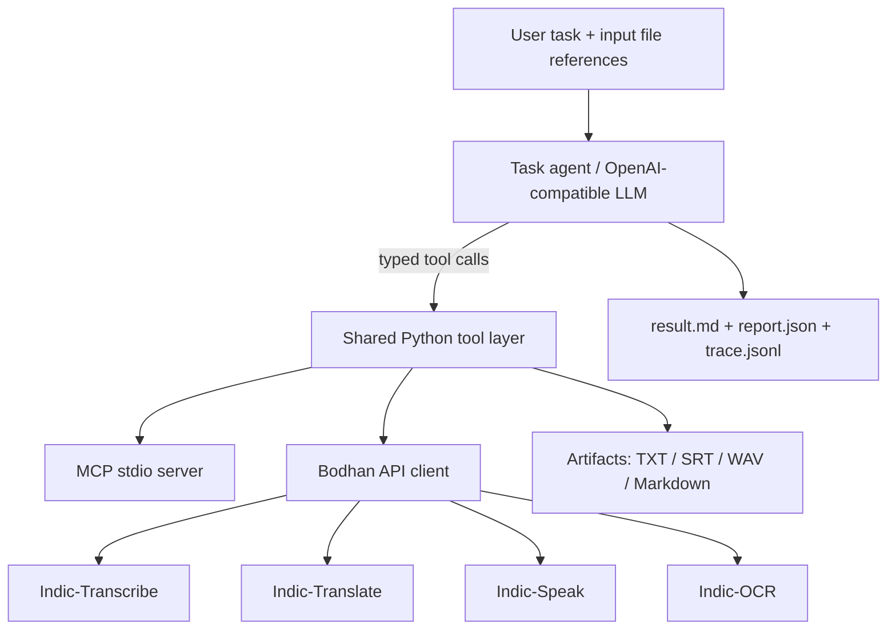
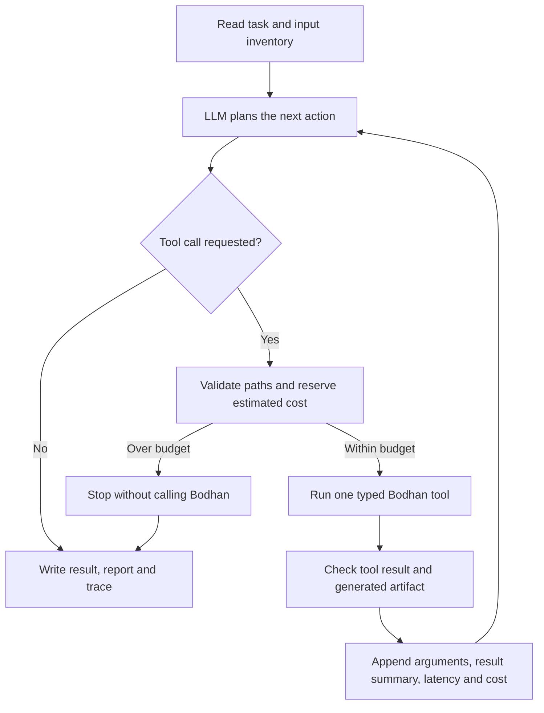

# Bodhan Tool Server and Task Agent

A Python implementation for the Bodhan AI Agentic Engineer take-home: a standalone MCP stdio server exposing Bodhan's Indic models, plus a budget-aware CLI agent that plans, executes, verifies and records multi-step tasks.

## How it works



The CLI agent and MCP server use the same typed tool functions. Media is passed between tools as local file references; OCR image bytes are encoded only inside the Bodhan HTTP request and are never placed in the LLM context. Tool arguments use filenames and paths, not inline base64 payloads.

### Agent loop



The LLM is only the planner/reasoner. Every OCR, speech-recognition, translation and speech-synthesis request is sent to the matching Bodhan model. The LLM may write English summaries and explanations, but the English-output tool blocks non-Latin alphabetic text; Indian-language text must come from Indic-Translate.

For the rationale behind tool boundaries, media handling, verification, budgets, caching and filesystem safeguards, see [Design notes](docs/DESIGN_NOTES.md). The demo scenarios are documented in [Demo scenarios](docs/DEMO_SCENARIOS.md); they must not be marked passed until real outputs have been reviewed.

## Implemented capabilities

- `indic-transcribe`: decodes audio locally, converts it to WAV and splits it into 29-second requests. Returns transcript text and chunk-level timing sidecar JSON.
- `indic-translate`: splits long text at natural boundaries, checks the `truncated` flag and rejects empty responses. Translation verification uses Bodhan back-translation where the source language is known reliably; ambiguous scripts are not guessed.
- `indic-speak`: splits text into short requests, concatenates Bodhan WAV responses, optionally exports MP3 locally with FFmpeg, and verifies the final audio by back-transcribing it with Bodhan Indic-Transcribe. Adds an adjacent AI-generated label sidecar.
- `indic-ocr`: renders scanned PDFs page-by-page with PyMuPDF and sends each PNG/JPEG page separately to Bodhan Indic-OCR. No local OCR fallback is used.
- MCP tools with typed inputs and outputs, actionable errors, input-file inventory and bounded text reads.
- CLI planning loop with OpenAI-compatible tool calling, max-step and rupee-cost limits, preflight cost reserves, per-run result caching and JSONL traces.
- Retry/backoff for rate limits and transient server/network errors; exhausted-credit responses are not blindly retried.
- Process-wide concurrency limit for Bodhan requests.
- Unit tests for chunking, cost calculations, audio chunking, translation truncation, page-by-page OCR, budget guards and a mocked multi-step OCR → translation → speech pipeline.

## Setup

Requirements: Python 3.11 or newer and FFmpeg installed and available on `PATH` (pydub uses it to decode audio and write WAV chunks). On Windows, open a new PowerShell window after installing FFmpeg and confirm with `ffmpeg -version`.

Using `uv` on Windows PowerShell:

```powershell
uv venv --python 3.13
.\.venv\Scripts\Activate.ps1
uv pip install -r requirements-dev.txt
uv pip install -e .
Copy-Item .env.example .env
```

Or install the project and its development tools using pip:

```powershell
python -m venv .venv
.\.venv\Scripts\Activate.ps1
python -m pip install -r requirements-dev.txt
python -m pip install -e .
Copy-Item .env.example .env
```

Edit `.env` on your own machine. Create model-specific keys in the [Bodhan console](https://console.bodhan.ai/) and configure all four keys. Configure an OpenAI-compatible LLM endpoint with tool calling for the task agent. Groq can be used by setting its OpenAI-compatible base URL and an appropriate tool-calling model; the project does not require an OpenAI API key.

```dotenv
BODHAN_TRANSCRIBE_KEY=your_transcribe_key
BODHAN_TRANSLATE_KEY=your_translate_key
BODHAN_SPEAK_KEY=your_speak_key
BODHAN_OCR_KEY=your_ocr_key

LLM_BASE_URL=https://api.groq.com/openai/v1
LLM_MODEL=your_tool_calling_model
LLM_API_KEY=your_llm_key
```

Never paste API keys into chat, commit them, or include them in traces. `.env` is ignored by Git; `.env.example` contains placeholders only.

## Run

Run tests first:

```powershell
pytest -q
ruff check src tests
```

Place your own permitted input files under `sample_data/` first; the repository intentionally contains no media files.

Run the task agent using the exact assignment interface:

```powershell
python -m bodhan_agent --task "Transcribe this Hindi voice note and give me English subtitles" --files .\sample_data\ --out .\out --max-steps 30 --max-cost-inr 20
```

The agent writes one folder per run:

```text
out/
  result.md
  artifacts/
  trace.jsonl
  report.json
```

Run the MCP server independently over stdio:

```powershell
python -m bodhan_mcp
```

It intentionally waits for an MCP host and does not print a startup banner to stdout, because stdout is the stdio protocol stream. For standalone use, set `BODHAN_MCP_ALLOWED_ROOT` to a dedicated workspace; the default is the current working directory. MCP outputs may be created anywhere in that workspace, but existing files outside `outputs/`, secret files and Git/virtual-environment directories are protected from overwrite. For an off-the-shelf MCP client check, launch the SDK's MCP Inspector from the project environment:

```powershell
mcp dev src/bodhan_mcp/server.py
```

The Inspector starts the server over stdio and lets you list and call its tools. It needs Node.js/npm (`npx`) on `PATH`. You can also configure a desktop/IDE MCP client to launch the `.venv` Python executable with arguments `-m bodhan_mcp` and set its working directory to this project folder so `.env` is loaded.

## Tool list

| Tool | Purpose |
|---|---|
| `inspect_files` | Lists supported audio, video, PDF, image and text file references without reading their contents |
| `transcribe_audio` | Bodhan speech-to-text; audio is sent in WAV windows shorter than 30 seconds |
| `translate_text_file` | Bodhan translation of a text/Markdown file with automatic chunking and optional back-translation verification |
| `translate_transcript_segments_to_srt` | Translates transcript sentences into SRT cues; times are estimated inside Bodhan ASR chunk boundaries, not word-level forced alignment |
| `synthesize_speech_from_file` | Bodhan text-to-speech with chunked input and Bodhan speech-to-text back-verification; WAV by default or MP3 when the output filename ends in `.mp3` |
| `ocr_document` | Bodhan OCR for PNG/JPEG or a multi-page PDF rendered one page at a time |
| `read_text_file` | Reads a bounded section of a UTF-8 text/Markdown file into the planner context |
| `write_english_text` | Writes English/Latin-script summaries and explanations only |

## Cost and safeguards

The assignment's published Bodhan rates are used: transcription ₹0.10/audio minute, translation ₹0.20/10,000 output tokens, speech ₹6/10,000 input characters and OCR ₹0.20/page. Translation estimates reserve a margin before paid calls; actual translation billing is taken from Bodhan's returned completion-token usage. The LLM provider's own charges are not included in `total_bodhan_cost_inr`.

The agent enforces `--max-steps`, `--max-cost-inr`, per-request HTTP timeouts and a process-wide concurrency ceiling. Each paid call has a preflight reserve; reported post-call usage is checked again and the agent stops if the estimate was exceeded. Each run records tool arguments, result summaries, latency, Bodhan cost, verifications and stop reason in `trace.jsonl` and `report.json`. Repeated identical tool requests in one run use a cache to avoid duplicate paid calls.

## Known limitations and trade-offs

- ASR timestamps are available only at the chunk level. SRT sentence cue timings are interpolated by character count within each chunk; they are approximate and not word-level forced alignment.
- Back-translation is skipped when Unicode script alone cannot identify a source language reliably (for example, Devanagari can represent several languages). Pass `source_language` when you know it.
- TTS back-transcription similarity is a diagnostic signal, not a formal speech-quality score. Listen to the audio before treating it as publication-ready.
- Very dense OCR tables may need tuning of page render resolution or the provider's per-block output-token limit.
- MP3 output is a local format conversion of Bodhan's WAV response; FFmpeg must be installed for this option.
- LLM provider compatibility depends on support for OpenAI-style chat-completions tool calling. The exact provider/model used for a submitted evaluation should be named in the PR.
- LLM token cost is not currently estimated. The rupee budget guard controls Bodhan API spend.
- End-to-end calls require valid Bodhan and LLM credentials. Tests mock API responses; no live paid API calls are made by the test suite.

## Submission checklist

Before submitting to the [Bodhan AI Cookbook](https://github.com/Bodhan-AI/Bodhan-AI-Cookbook):

1. Copy this project as a self-contained recipe under `examples/bodhan_tool_server_agent/` in your fork and read the current `CONTRIBUTING.md`.
2. Run `make check` from the Cookbook repo and fix its recipe-validator/lint findings.
3. Execute and capture at least six demo tasks, including an impossible unsupported-language task; link output and trace files from the recipe README.
4. Connect the MCP server to at least one off-the-shelf MCP client and capture a successful tool test.
5. Record a demo video of five minutes or less; describe trade-offs, costs and limitations in the PR.
6. Submit the exact final commit SHA and PR link in the assignment email thread before the deadline.

## AI assistance

OpenAI ChatGPT is used to help inspect assignment requirements, design the architecture, draft and debug code, write tests and documentation. The developer reviews and must be able to explain every part of the implementation.
